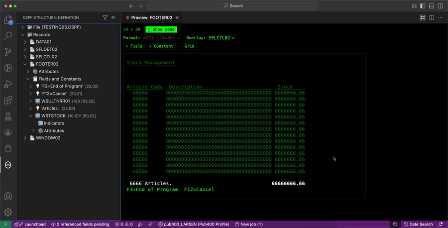

# DSPF-edit

**DSPF-edit** turns DDS display-file editing into a visual, live experience right inside VS Code — see the screen you're building as you build it, instead of guessing until you compile.

> 📖 **New here? Start with the [Quick Start](https://christianlarsen.github.io/dspf-edit/quickstart/)** — a few minutes from opening a display file to seeing its screen. Everything else is in the **[full manual](https://christianlarsen.github.io/dspf-edit/)**.

---

## Why DSPF-edit?

### STRSDA is gone. Your screens aren't.

Starting with **IBM i 7.6**, IBM has withdrawn **Screen Design Aid (STRSDA)** from the Application Development ToolSet ([IBM: planning an upgrade to IBM i 7.6](https://www.ibm.com/support/pages/planning-upgrade-ibm-i-76-software)). Your display files are still there, still compiling, still running the business. What's gone is the tool most of us used to draw them.

So how do you change a screen now?

- **By hand** — counting columns 7 to 80 in SEU or a text editor, and compiling to see what you got.
- **RDi** — a full IDE, with a paid licence.
- **DSPF-edit** — free and open source, right inside VS Code.

IBM itself lists **Code for i** among SDA's replacements. If you already write RPG, CL and SQL in VS Code with Code for i, your screens belong there too: one editor, one connection, one workflow — no jumping back to a 5250 session or into a second IDE just to move a field.

### What you get

- **The screen and its source, side by side and in sync.** Type in the source and the screen redraws; drag on the screen and the source changes.
- **Run it in your head, not on the system.** Turn indicators on and off, see error messages on the message line, windows where they open, every subfile row, and each display size — without compiling.
- **More than the screen designer ever did.** Selection fields with radio buttons and check boxes, as your emulator shows them. More than 3 indicators and OR'd conditions, with the continuation lines written for you. Keys and keywords that won't compile, caught before you compile.
- **Connected to your IBM i** through Code for i: referenced fields resolved from the database, and your system's decimal format, date separator and edit codes in the preview.

DSPF-edit doesn't replace your compiler — it closes the gap between writing DDS and seeing the screen it produces, matching real **STRSDA** behavior field by field, so what you preview is what you get.

---

## 📖 The manual

Everything DSPF-edit does is explained, step by step and with screenshots, in the **[DSPF-edit manual](https://christianlarsen.github.io/dspf-edit/)**. This README only lists the features: the manual tells you how to use them, what each keyword does on the real screen, and why the preview shows what it shows.

| Start here | Building screens | Going further |
|---|---|---|
| [Install](https://christianlarsen.github.io/dspf-edit/install/) | [Records](https://christianlarsen.github.io/dspf-edit/guides/records/) | [Windows](https://christianlarsen.github.io/dspf-edit/guides/windows/) |
| [Quick Start](https://christianlarsen.github.io/dspf-edit/quickstart/) | [Fields](https://christianlarsen.github.io/dspf-edit/guides/fields/) | [Subfiles](https://christianlarsen.github.io/dspf-edit/guides/subfiles/) |
| [Structure tree](https://christianlarsen.github.io/dspf-edit/guides/schema-tree/) | [Constants](https://christianlarsen.github.io/dspf-edit/guides/constants/) | [Multiple display sizes](https://christianlarsen.github.io/dspf-edit/guides/display-sizes/) |
| [Screen Preview](https://christianlarsen.github.io/dspf-edit/guides/screen-preview/) | [Indicators and conditions](https://christianlarsen.github.io/dspf-edit/guides/indicators/) | [Referenced fields](https://christianlarsen.github.io/dspf-edit/guides/referenced-fields/) |
| [Configuration](https://christianlarsen.github.io/dspf-edit/guides/configuration/) | [Colors and attributes](https://christianlarsen.github.io/dspf-edit/guides/colors-attributes/) | [Column ruler](https://christianlarsen.github.io/dspf-edit/guides/column-ruler/) |
| [Help and support](https://christianlarsen.github.io/dspf-edit/help-and-support/) | [Command keys](https://christianlarsen.github.io/dspf-edit/guides/command-keys/) | |

---

## ✨ Features

### 🖥️ Screen Preview — see it before you compile

**What it shows**
  - A green-screen-style preview of a record: fields and constants with their colors and `DSPATR` attributes, and placeholders for output, input and both fields.
  - Numbers edited with `EDTCDE()`/`EDTWRD()` as they'll look, with the decimal and date separators set in the "⚙ Configuration" panel (or read from the connected IBM i), including the system's user-defined edit codes `EDTCDE(5)` to `EDTCDE(9)`.
  - A field coded with `CNTFLD(n)` wraps across several lines, `n` characters each, all starting at its column — as RDi previews it. A field too long for its line wraps as the system does.
  - Selection fields (`SNGCHCFLD`/`MLTCHCFLD`) show radio buttons or check boxes, as emulators show them, or numbered choices as the screen designer does — set in the "⚙ Configuration" panel's **Display Type**.
  - A function-key legend (`F3`, `F12`, ...) with every command key available to the record (file and record level). A key whose indicator condition isn't met still shows, dimmed; it's highlighted when it's active.
  - An active `ERRMSG()`/`ERRMSGID()`, or a subfile's `SFLMSG()`, shows on the message line (a window's own, unless it has `*NOMSGLIN`); `ERRMSG()` takes priority over `SFLMSG()`, as in the DDS reference.

**Indicators and display sizes**
  - Turn indicators on and off to see which fields, constants and attributes show.
  - "◌ Hidden" shows what isn't visible right now — conditioned on indicators that are off, or with `DSPATR(ND)` — as dotted outlines. Hovering one says why it's hidden.
  - For files with more than one `DSPSIZ` format (`*DS3`/`*DS4`), switch which one is previewed: window positions and sizes and conditioned elements are resolved for it, and changes made in the preview only affect that size.
  - The indicators and the display format chosen stay when switching to another record.

**Editing on the screen**
  - Drag fields and constants to move them.
  - "+ Field" / "+ Constant": click a point on the screen to add one there, with the same prompts as the tree.
  - Select one element, several (Ctrl/Cmd+click) or a whole area ("⬚ Area") to get the "⋮ Actions" menu — also on right-click: colors, attributes, copy, delete, and for a single element the same commands as the tree (rename, indicators, validity checks, keying options, editing keywords, error messages, choices...). Several elements can be aligned left, center or right.
  - "Copy Format..." copies a field or constant's colors, attributes, indicators and/or number editing; "Paste Format" applies them to the selected elements.
  - `Delete`/`Backspace` deletes the selected elements, after confirming.

**Windows**
  - `WINDOW` records are drawn at their real position, with their title (`WDWTITLE`) and border; resize and move them with the mouse. Windows shared through `WINDOW(record-name)` are supported.
  - Click a window's title to edit it. Its "⋮" menu aligns it (left, center or right; top, center or bottom) or changes its position: fixed, relative to the cursor (`*DFT`) or at a line and position in fields.

**Subfiles**
  - All `SFLPAG` rows are shown, with the subfile's control and detail records together; detail rows can't be dragged over the control record's content.
  - A horizontal subfile (`SFLLIN`) shows its records in several columns.
  - The `SFLDROP`/`SFLFOLD` key switches between truncated and folded, as on the real screen.

**Several records at once**
  - Overlay other records, dimmed, behind the one being previewed, to see how they compose. A subfile's two records, and the record named in `WINDOW(record-name)`, come along on their own (configurable).
  - Double-click a dimmed record to switch the preview to it.

**The panel**
  - A compact toolbar: size, display format, overlay, indicators, add buttons.
  - Stays in sync with the structure tree, in both directions.
  - "Focus" makes the preview fill the editing area; "Show code" brings the source back.
  - "? Manual" opens the manual's guide for what you're previewing (windows, subfiles, the preview itself).

📖 Manual: [Screen Preview](https://christianlarsen.github.io/dspf-edit/guides/screen-preview/) · [Windows](https://christianlarsen.github.io/dspf-edit/guides/windows/) · [Subfiles](https://christianlarsen.github.io/dspf-edit/guides/subfiles/) · [Multiple display sizes](https://christianlarsen.github.io/dspf-edit/guides/display-sizes/)

### 🧭 Structure tree
  - Shows the file, its records, and each record's fields, constants and keywords; click any of them to jump to its line.
  - An OR'd condition is grouped into its ANDed parts ("Group 1 (AND)" / "OR" / ...); hovering a conditioned element shows the whole condition (e.g. `51 AND NOT 61 AND 53  OR  52`).
  - Right-click for what applies to each element:

**File**
  - New record.
  - Command keys: add, change, remove or condition with indicators. Keys that won't compile are caught: the same key as CA in one place and CF in another, or at both file and record level.
  - Add Display Size: a second standard size (`*DS3`/`*DS4`) for a file that declares only one.
  - Change Input Default (`CHGINPDFT`): removes the automatic underline of input fields.
  - Reference File (`REF`): the database file referenced fields take their definition from.

**Records**
  - New, copy, delete, sort elements, and preview (also an inline button on the record).
  - Add field, add constant, add "buttons" (constants for the record's command keys).
  - Command keys and indicators, as at file level; Change Input Default for the record.
  - Overlay (`OVERLAY`) and Return Cursor Location (`RTNCSRLOC`, and `SFLCSRRRN` on subfiles), creating and deleting their hidden fields.
  - Subfile control records: Add Commands Record, Subfile Drop/Fold (`SFLDROP`/`SFLFOLD`), Subfile End (`SFLEND`), Subfile Record Number (`SFLRCDNBR`) and Subfile Columns (`SFLLIN`).
  - Window records: Change Window Size (every display size at once), Change Window Position and Change Window Title.

**Fields**
  - Edit (name, size, alphanumeric ↔ numeric, offering to remove keywords that no longer apply), rename, copy, remove.
  - Position: absolute, relative to another element, or centered.
  - Colors and attributes; indicators, with up to 9 ANDed indicators (continuation lines written for you) and OR'd conditions.
  - Validity checks, keying options (`CHECK`), editing keywords (`EDTCDE`/`EDTWRD`/`EDTMSK`) and error messages (`ERRMSG`/`ERRMSGID`).
  - Split into lines (`CNTFLD`).
  - Selection fields: Add Field creates single-choice (radio buttons) and multiple-choice (check boxes) fields with their choices; **Choices** changes, adds, removes and arranges them, with the control fields (`CHCCTL`) of a multiple-choice field.

**Constants**
  - Edit, copy, remove, fill with characters.
  - Position, colors and attributes, and indicators, as for fields.

**Attributes**
  - Change their indicators, or remove them.

📖 Manual: [Structure tree](https://christianlarsen.github.io/dspf-edit/guides/schema-tree/) · [Records](https://christianlarsen.github.io/dspf-edit/guides/records/) · [Fields](https://christianlarsen.github.io/dspf-edit/guides/fields/) · [Constants](https://christianlarsen.github.io/dspf-edit/guides/constants/) · [Indicators](https://christianlarsen.github.io/dspf-edit/guides/indicators/) · [Command keys](https://christianlarsen.github.io/dspf-edit/guides/command-keys/)

### ✅ Help while editing the source
  - Column ruler: the DDS format line (`.....AAN01N02N03T.Name++++++RLen++TDpBLinPos...`) above the line being edited, with each column area outlined; hover an area to see its name. `Shift+F4` turns it on and off.
  - Mistakes the compiler would reject are underlined and listed in the **Problems** panel, with the compiler's message ID where confirmed and a Quick Fix where it's clear what was meant:
    - Indicators in the wrong columns (e.g. `50` typed one column early), and display size names such as `*DS4` out of place.
    - `SFLDROP`/`SFLFOLD` on a subfile where `SFLPAG` equals `SFLSIZ` (`CPF7885`).

📖 Manual: [Column ruler](https://christianlarsen.github.io/dspf-edit/guides/column-ruler/) · [Indicators in the wrong columns](https://christianlarsen.github.io/dspf-edit/guides/indicators/#indicators-in-the-wrong-columns) · [SFLPAG equal to SFLSIZ](https://christianlarsen.github.io/dspf-edit/guides/subfiles/#sflpag-equal-to-sflsiz)

### 🔗 With a connection to IBM i
Through the [Code for i](https://marketplace.visualstudio.com/items?itemName=HalcyonTechLtd.code-for-ibmi) extension:
  - Resolve Referenced Field: the real type, length and decimals of a referenced field, with its own overrides (e.g. `+4`) applied on top — or straight from the source for one referencing a field of the same source (`*SRC`), no connection needed. "Resolve All Referenced Fields" in the status bar does every pending one at once.
  - The decimal format (`QDECFMT`), the date separator (`QDATSEP`) and the user-defined edit codes, read with one click from the "⚙ Configuration" panel.

📖 Manual: [Referenced fields](https://christianlarsen.github.io/dspf-edit/guides/referenced-fields/) · [Configuration](https://christianlarsen.github.io/dspf-edit/guides/configuration/)

### 🎛️ Configuration panel
  - Preview colors, decimal format and date separator, and **Display Type** (graphical or text only).
  - How **New Record** creates windows: asking, at a fixed position, or relative to the cursor.
  - Which records the preview overlays on its own, and the column ruler.

📖 Manual: [Configuration](https://christianlarsen.github.io/dspf-edit/guides/configuration/)

---

## 🚀 How to Use

1. Open a DDS display file in VS Code.  
2. Go to **explorer view** in VS Code.
3. The **schema view** will appear automatically with the name "DSPF STRUCTURE".  
4. Use **left-click** to navigate, or **right-click** to access contextual options.  

The **[Quick Start](https://christianlarsen.github.io/dspf-edit/quickstart/)** walks you through it with screenshots, and the **[full manual](https://christianlarsen.github.io/dspf-edit/)** covers every feature.

---

## ⚙️ Requirements

- Visual Studio Code **v1.75** or higher.

---

## 🐞 Known Issues

No known blocking issues right now. Please [open an issue](https://github.com/christianlarsen/dspf-edit/issues) if something isn't working as expected!

---

## 📝 To Do

- Bug fixes.  
- Support removing a declared display size.  
- Many new features to come!  

---

## 📦 Version History
See the full changelog [here](./CHANGELOG.md).

### Latest
**1.19.0** - 2026-11-17
- Added: the preview shows horizontal subfiles (`SFLLIN`) in several columns of records, as the system does.
- Added: **Subfile Columns** on `SFLCTL` records adds, changes or removes `SFLLIN`.
- Added: `SFLDROP`/`SFLFOLD` where `SFLPAG` equals `SFLSIZ` is flagged as an error (`CPF7885`), with Quick Fixes to make `SFLSIZ` one more than `SFLPAG` or remove the keyword.
- Added: selection fields: **Add Field** creates single-choice (radio buttons) and multiple-choice (check boxes) fields with their choices, and **Choices** changes, adds, removes and arranges them.
- Added: a **Display Type** setting; graphical by default, so selection fields preview with radio buttons and check boxes, as emulators show them.
- Changed: the preview no longer offers the fold/truncate key when `SFLPAG` equals `SFLSIZ`.

---

## ⭐ Enjoying DSPF-edit?

If it's saving you trips to SEU or STRSDA, please consider [leaving a rating on the Marketplace](https://marketplace.visualstudio.com/items?itemName=ChristianLarsen.dspf-edit&ssr=false#review-details) — it takes 10 seconds and is the single biggest thing that helps other IBM i developers find it.

💬 **Feedback is welcome!** Please leave a comment, [open an issue](https://github.com/christianlarsen/dspf-edit/issues), and enjoy using DSPF-edit.
